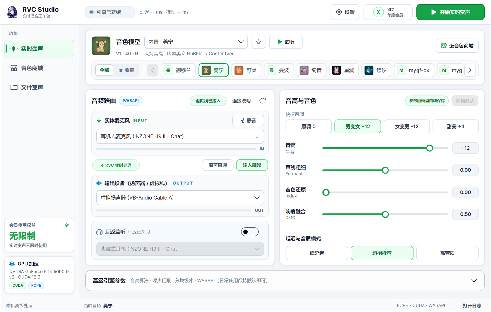
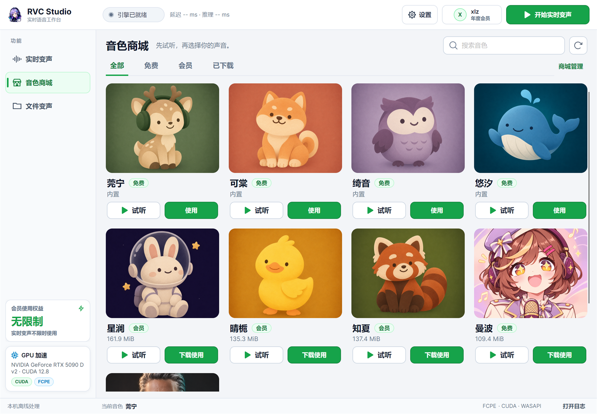
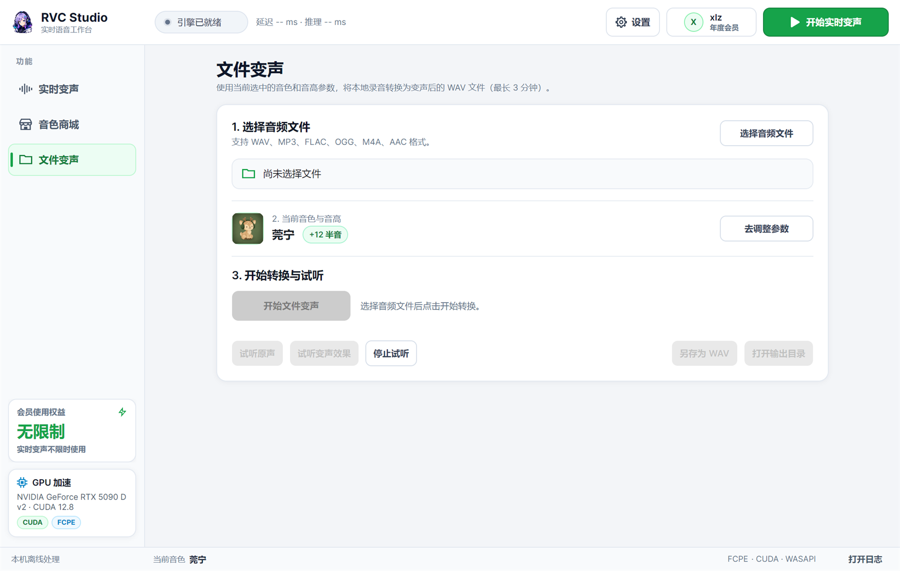

# RVC Studio

**面向 Windows 和 NVIDIA RTX 的本地实时变声工作台**

[下载 Windows 版](https://github.com/3egirlsdream/RvcStudio/releases/latest) · [产品官网与音色试听](https://3egirlsdream.github.io/RvcStudio/) · [界面预览](#界面预览) · [反馈问题](https://github.com/3egirlsdream/RvcStudio/issues)

用内置音色或自己的 RVC 模型实时转换麦克风声音，并通过虚拟声卡把变声后的声音送入游戏、QQ、Discord 或 OBS。也可以导入录音，在同一个窗口里完成转换、试听和导出。实时语音和录音文件都在本机处理。

## 界面预览

### 实时变声工作台

一屏完成音色切换、麦克风和输出设备选择，以及音高、声线粗细和响度调节。支持耳返监听、原声直通、麦克风静音和全局快捷键，可在低延迟、均衡与高音质模式之间切换。

### 音色商城

按名称搜索音色，或按免费、会员、已下载筛选。可以先试听样音，再选择要使用的音色。客户端自带 4 款免费音色，也支持导入自己的 `.pth` 模型与可选的 `.index` 索引。

### 文件变声

选择已有录音，应用当前音色和音高设置。支持 WAV、MP3、FLAC、OGG、M4A、AAC 输入，单个文件最长 3 分钟。转换后可以对比原声和变声效果，并另存为 WAV。

## 下载安装

1. 打开 [最新版 Release](https://github.com/3egirlsdream/RvcStudio/releases/latest)，点击版本说明里的 Hugging Face 下载链接，获取 `RVC-Studio-NVIDIA-Setup.exe`。
2. 运行安装程序。完整安装包已内置 Python、PyTorch CUDA 运行库和默认音色。需要把变声送入其他软件时，可在安装时勾选标准版 VB-CABLE。
3. 打开 RVC Studio，选择音色和麦克风，点击「开始实时变声」。打开「耳返监听」即可在耳机里确认效果。

使用 VB-CABLE 时，在 RVC Studio 选择 **CABLE Input** 作为输出设备，在 QQ、Discord、游戏或 OBS 里选择 **CABLE Output** 作为麦克风。

已有 1.1.0 或更新版本的用户，可在软件内检查更新。运行环境兼容时可直接下载小包更新。

## 运行要求

| 项目 | 要求 |
| --- | --- |
| 操作系统 | 64 位 Windows 10 22H2 或 Windows 11 |
| 显卡 | NVIDIA GeForce RTX 20、30、40 或 50 系列 |
| 显卡驱动 | 支持 CUDA 12.8，建议 NVIDIA 驱动 572.61 或更新版本 |
| 音频设备 | Windows 可识别的麦克风。耳返监听建议使用耳机 |
| 网络 | 账号登录、会员同步、商城下载和版本检查需要联网 |

## 免费使用与会员

每台未开通会员的设备每天有 1 小时免费实时变声时长，仅在实时变声运行期间计时。会员有效期内实时变声不限时，并可使用商城会员音色。

## 反馈与许可

遇到安装、设备或变声问题，可通过 [GitHub Issues](https://github.com/3egirlsdream/RvcStudio/issues) 反馈。请附上软件版本、Windows 版本、显卡型号和复现步骤。

RVC Studio 基于 [RVC](https://github.com/RVC-Project/Retrieval-based-Voice-Conversion-WebUI) 开发。项目许可见 [MIT License](LICENSE)，第三方组件与资源的许可声明随安装包提供。
